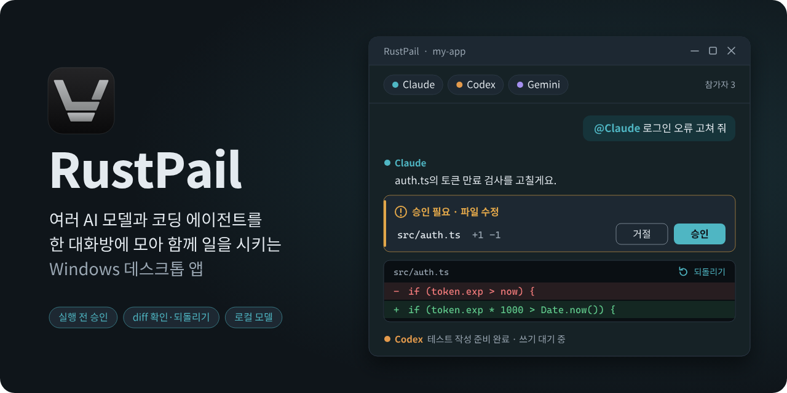

# RustPail



**여러 AI 모델과 코딩 에이전트를 한 대화방에 모아 함께 일을 시키는 Windows 데스크톱 앱입니다.**

Codex, Claude Code, Cursor, Grok 같은 AI 코딩 CLI와 Claude, OpenAI, Gemini, xAI 같은 API 모델, 내 PC의 Ollama를 앱 하나에서 씁니다. 프로젝트 폴더를 열고 대화로 일을 맡기면, 에이전트가 파일을 고치거나 명령을 실행하기 전에 RustPail이 먼저 묻습니다. 바뀐 파일은 diff로 확인하고 마음에 들지 않으면 되돌립니다.

> 이 저장소는 **설치 파일과 사용 안내만** 배포합니다. 소스 코드는 들어 있지 않습니다.

## 할 수 있는 일

### 여러 모델이 한 대화방에서

- **참가자 여러 명**: 한 대화방에 모델을 여럿 넣고 `@이름`으로 불러 일을 나눕니다. 모델마다 별명과 역할을 줄 수 있고 같은 모델을 여러 명 넣어 각자 다른 일을 맡길 수도 있습니다(모델당 최대 4명, 방 전체 8명).
- **기다리지 않고 동시에**: 한 모델이 답하는 중에도 다른 모델에게 보낼 수 있습니다. 파일 쓰기와 명령 실행은 한 번에 한 모델만 하고 나머지는 쓰기 대기를 합니다.
- **순서대로 넘기기(릴레이)**: `@A 계산해 줘 @B A의 답으로 이미지 만들어 줘`처럼 쓰면 앞 모델의 답이 뒤 모델에게 넘어갑니다. 보내기 단추 옆 칩에 "순서대로"인지 "동시에"인지 보이고 한 번 눌러 바꿀 수 있습니다. `@모두`는 항상 동시에 보냅니다.
- **모델끼리 일 맡기기**: 대화방 안의 모델이 다른 참가자에게 질문하고 답을 받아 올 수 있습니다. "클로드는 코드 검토, 코덱스는 버그 수정을 맡아 줘"처럼 말하면 모델이 별명과 역할을 직접 정리하기도 합니다. 위임은 한 단계까지만 되고 한 번에 부를 수 있는 횟수에도 한도가 있습니다.
- **터미널 속 에이전트 보기**: 터미널 모드에서 돌고 있는 에이전트의 화면을 대화방의 모델이 읽을 수 있습니다. 터미널에 글자를 입력하는 일은 입력할 글을 그대로 보여 주는 승인 카드를 항상 거칩니다.
- **공유 메모판**: 대화방마다 사용자와 모델이 함께 읽고 쓰는 짧은 메모판이 있습니다.
- **대화 이어 쓰기**: 모델의 세션을 다음 턴에도 이어 가서 긴 대화에서도 전체를 매번 다시 보내지 않습니다. 설정에서 끌 수 있고 끄면 매 턴 전체 대화를 다시 보냅니다. 이어 쓰기를 따라가지 못하는 변경(요약, 되돌리기 등)이 생기면 다음 턴은 알아서 새 세션으로 시작합니다.
- **긴 대화 정리**: `/compact`로 요약해서 이어 갑니다. 요약된 메시지는 지워지지 않고 되돌릴 수 있습니다.

### 일은 에이전트가, 허락은 내가

- **승인 카드**: 파일 수정이나 명령 실행 앞에서 카드가 뜹니다. 실행 방식은 **승인 후 실행 / 자동 실행 / 읽기 전용** 중에서 고릅니다.
- **되돌리기**: 턴마다 체크포인트가 남아서 파일 하나든 턴 전체든 되돌릴 수 있습니다. git 저장소가 아닌 폴더도 턴 전후를 비교해 되돌립니다.
- **변경 확인**: 변경 탭에서 파일 트리와 diff를 함께 봅니다. 바뀌지 않은 줄은 접힙니다.
- **내장 브라우저**: 에이전트가 앱 안 브라우저를 조작합니다. 처음 가는 사이트는 먼저 묻고 결제·삭제·전송처럼 되돌리기 어려운 단추는 한 번 더 확인합니다. 허용할 사이트 목록을 직접 관리할 수 있습니다.

### 사용량과 한도

- 공급자가 알려 주는 사용 한도를 막대로 보여 주고 소진 시점을 예측해 줍니다. 공급자별 사용 비율과 API 사용량(토큰, 예상 비용, 월 예산 경고)도 설정 › 사용량에서 봅니다.
- 한도가 80%, 95%에 가까워지면 알림이 오고 한도가 다시 풀릴 때도 알려 줍니다.
- 표시되는 한도와 비용은 공급자가 알려 주는 값과 앱이 센 토큰 수에서 나온 **참고용 값**입니다. 실제 청구와 다를 수 있습니다.

### 파일과 편집기

- 프로젝트의 파일을 앱 안에서 열어 보고 다른 앱(내 편집기 등)으로 열 수 있습니다. 확장자별로 열 앱을 정해 둘 수 있습니다.
- 파일과 이미지를 끌어다 놓거나 붙여 넣고 화면 일부를 잘라 바로 첨부합니다. 이미지를 볼 수 있는 모델에는 이미지를 함께 보냅니다.
- 이미지 보기에서 펜, 형광펜, 화살표, 사각형, 글자로 표시를 하고 새 이미지로 저장하거나 작성창에 붙일 수 있습니다.
- 만든 프로그램을 앱 안에서 실행하고 실행 기록과 오류를 모델에게 넘겨 고치게 할 수 있습니다. 처음 보는 실행 명령은 먼저 묻습니다.

### 터미널 모드

- 앱 안에서 터미널 창을 여러 개 나눠 놓고 AI CLI를 그대로 실행합니다. 에이전트의 상태(작업 중, 입력 기다림 등)를 알아봅니다.
- 창 배치는 저장해 두었다가 다시 불러옵니다.

### 확장

- 스킬, MCP 서버, 각 CLI의 플러그인을 앱 안에서 둘러보고 설치·관리합니다.
- `/`를 치면 RustPail 명령과 함께 스킬, 플러그인, 각 CLI의 사용자 정의 명령이 후보로 뜹니다.

### 내 손에 맞게

- 테마 여러 종, 강조색, 글꼴, 색약용 diff 색, 단축키, 창 배치를 바꿉니다.
- `Ctrl+K` 명령 팔레트, 알림 센터, 대화 상태 표시(막힘, 작업 중, 검토 준비, 완료)가 있습니다.
- 대화를 별도 창으로 떼어 나란히 놓을 수 있고 프로젝트 하나에 폴더를 여러 개 묶을 수도 있습니다.
- 대화를 내보내거나 앱 데이터를 모두 지울 수 있습니다.
- 기능마다 짧은 튜토리얼이 있습니다(설정 › 도움말, 제목 줄의 ? 단추). 처음 보는 기능 옆에는 안내 카드가 뜨고 하나씩 또는 한꺼번에 건너뛸 수 있습니다.
- 창을 닫으면 트레이로 들어가 하던 일을 계속합니다. 끝내려면 트레이 메뉴에서 종료를 누릅니다.

### 휴대폰에서 이어 쓰기

휴대폰에서 QR로 PC와 짝을 지으면 대화를 읽고 승인 카드에 답하고 새 지시를 보낼 수 있습니다. PC에서 RustPail이 켜져 있어야 합니다. 이 기능은 **중계 서비스가 따로 필요**합니다. 설치 파일에는 바로 쓸 수 있는 공용 서비스 주소가 들어 있지 않으며 서비스를 운영하는 사람이 알려 준 주소를 설정에 넣어야 연결됩니다.

## 연결할 수 있는 곳과 필요한 계정

RustPail은 모델을 대신 제공하지 않습니다. 쓰려는 서비스의 계정이나 키를 직접 준비해야 하고 그 서비스의 이용 약관과 요금은 각 서비스를 따릅니다.

| 종류 | 대상 | 필요한 것 |
|---|---|---|
| 공식 CLI | Codex, Claude Code, Antigravity, Cursor, Grok, Qwen Code, Goose | 해당 CLI를 이 PC에 설치하고 그 CLI에 로그인. 앱 안에서 설치와 로그인을 도와 줍니다. 로그인은 CLI가 하며 RustPail은 CLI의 인증 파일을 읽지 않습니다. |
| API 키 | Claude, OpenAI, Gemini API, xAI | 각 서비스의 API 키. 키는 Windows 자격 증명 관리자에 보관합니다. |
| 로컬 | Ollama | 이 PC에서 돌고 있는 Ollama 서버. 계정이 필요 없습니다. 모델을 몰래 내려받지 않습니다. |

- **에이전트 모드와 대화 전용**: 공식 CLI 7곳은 프로젝트 폴더에서 파일을 읽고 고치고 명령을 실행하는 에이전트 모드로 돕니다. Ollama와 API 키로 쓰는 곳은 **대화만** 하며 빈 임시 폴더에서 실행되고 파일·명령 요청은 모두 거절합니다.
- **Gemini CLI**는 Google이 일부 개인 계정 지원을 끝냈다고 알려 와서 목록에서 뺐습니다. Antigravity나 Gemini API 키를 쓰세요.
- **OpenCode**는 승인 설정이 실제로 적용되는지 확인하지 못해 연결을 꺼 두었습니다.
- Grok, Qwen Code, Goose, Cursor 등은 구독이나 무료 사용 조건이 서비스 쪽에서 바뀔 수 있습니다. 연결할 때 보이는 안내를 읽고 이용 가능 여부는 해당 서비스에서 확인해 주세요.
- **승인의 한계**: Grok, Qwen Code, Goose는 RustPail로 오는 요청(파일 읽기·쓰기, 터미널, 허용 요청)에만 승인 카드가 뜹니다. 이 CLI들이 **자기 도구**로 하는 일은 RustPail이 검사하거나 막을 수 없습니다. 연결할 때 보이는 동의 화면에 같은 내용이 적혀 있고 다른 CLI의 남은 한계도 각 동의 화면에 적혀 있습니다.
- **되돌리기의 한계**: RustPail이 고치기 전 내용을 남겨 둔 파일만 되돌릴 수 있습니다. Antigravity에서는 명령이 바꾼 파일이 되돌리기 대상이 아닙니다.

## 설치, 업데이트, 제거

**필요한 것**: Windows 10 또는 11(64비트). 쓰려는 AI CLI를 설치하고 로그인하거나 API 키를 준비하세요.

### 설치

1. [Releases](../../releases)에서 `_x64-setup.exe`로 끝나는 설치 파일과, 같은 이름에 `.sha256`이 붙은 파일을 내려받습니다.
2. 내려받은 파일이 맞는지 PowerShell에서 확인합니다. 출력값이 `.sha256` 파일 내용과 같아야 합니다.

   ```powershell
   (Get-FileHash .\<내려받은 설치 파일>.exe -Algorithm SHA256).Hash
   ```

3. 설치 파일을 실행합니다. 내 계정에만 설치되는 사용자 단위 설치라 관리자 권한이 필요 없습니다.
4. 코드 서명이 아직 없는 설치 파일이라 Windows SmartScreen이 경고를 띄웁니다. 위 SHA-256 확인을 마쳤다면 **추가 정보 → 실행**을 누르세요.

### 업데이트

설정 › 정보 › 업데이트에서 새 버전을 확인하고 "지금 업데이트"로 설치합니다. 자동 확인은 끌 수 있습니다. 앱은 이 저장소의 릴리스만 확인하고 받은 파일의 크기와 SHA-256을 확인한 뒤에만 설치합니다.

> 업데이트 파일은 SHA-256으로만 검증하고 서명 검증은 아직 없습니다. 이 저장소의 계정이 탈취되는 경우는 앱이 막지 못합니다.

### 제거

Windows 설정 › 앱에서 RustPail을 제거합니다. 앱 데이터(대화, 설정)는 남을 수 있습니다. 확실히 지우려면 제거 전에 설정 › 저장 공간의 "데이터 전체 삭제"를 쓰세요. 이 기능은 대화, 프로젝트 목록, 앱 설정, 체크포인트, 첨부 이미지를 지우며 로그인 정보와 API 키, 프로젝트 파일은 지우지 않습니다.

## 데이터와 개인정보

- **내 PC에 저장**: 대화, 설정, 체크포인트는 이 PC에만 저장됩니다. RustPail 운영자의 서버로 대화나 코드를 보내지 않습니다.
- **AI 서비스로 가는 내용**: 대화와 코드는 내가 고른 CLI나 API를 통해서만 해당 AI 서비스로 전달됩니다. 클라우드 모델은 고르거나 연결할 때 서비스마다 한 번 "무엇이 어디로 가는지" 묻고 설정에서 언제든 끌 수 있습니다. 프로젝트마다 클라우드 전송을 막아 로컬 모델만 쓰게 할 수도 있습니다.
- **API 키**: Windows 자격 증명 관리자에 보관합니다. 대화 저장 파일과 내보내기에는 들어가지 않습니다.
- **서비스 쪽에 남는 기록**: 대화 이어 쓰기를 켜면 대화가 각 서비스의 서버나 각 CLI의 세션 기록에 남을 수 있습니다(예: OpenAI와 xAI는 응답을 일정 기간 보관). **RustPail에서 대화를 지워도 그쪽 기록은 지우지 않습니다.** 지우려면 각 서비스나 CLI에서 직접 지워야 합니다. 설정의 안내 문구에도 같은 내용이 있고 원치 않으면 "모델 세션 이어 쓰기"를 끄세요.
- **몰래 내려받지 않음**: 모델이나 로컬 서버를 허락 없이 내려받거나 실행하지 않습니다.
- **휴대폰 원격 제어**: PC와 휴대폰이 직접 연결되고 오가는 내용은 짝을 지을 때 정한 키로 한 번 더 암호화됩니다. 중계 서비스는 연결만 이어 줍니다.

## 알려진 한계

- 코드 서명이 없어 처음 설치할 때 SmartScreen 경고가 뜹니다.
- 업데이트는 SHA-256 확인만 하며 서명 검증이 없습니다.
- 휴대폰 원격 제어는 중계 서비스가 있어야 하며 푸시 알림과 통신사망 같은 다른 망에서의 연결은 실제 기기에서 확인하지 못했습니다.
- 각 CLI가 자기 도구로 하는 일(웹 검색 포함)은 RustPail의 승인 카드를 거치지 않을 수 있습니다. 위 "승인의 한계"를 확인하세요.
- 순서대로 넘기기(릴레이)와 같은 모델 여러 명 기능은 실제 사용 환경에서의 확인이 아직 부족합니다. 특히 같은 모델 참가자가 섞인 릴레이가 그렇습니다.
- 공유 메모판에 내용이 있으면 요약이 매 턴 함께 전달되어 토큰이 조금 더 듭니다.
- 비용 표시에서 캐시된 토큰은 일반 토큰 값으로 계산되어 실제보다 많게 보일 수 있습니다.
- Windows 전용입니다. macOS와 Linux 버전은 없습니다.

## 지원

- 사용 중 문제나 제안은 이 저장소의 [Issues](../../issues)에 남겨 주세요. 대화 내용, API 키, 개인정보는 올리지 마세요.
- 보안 문제는 Issues에 공개로 올리지 말고 이 저장소의 Security 탭에서 비공개로 알려 주세요.

## 라이선스와 고지

RustPail 앱과 직접 작성한 코드는 오픈소스가 아니며 Copyright (c) 2026 BlackBuddle, All rights reserved입니다. 소스는 공개하지 않고, 설치 파일은 공식 릴리스를 통해 개인 용도로만 제공합니다. 서면 허락 없이 복사·수정·역공학·재배포할 수 없습니다.

RustPail은 [Herdr](https://github.com/herdrdev/herdr)의 터미널 런타임을 바탕으로 만들었습니다. Herdr에서 가져온 코드와 그 코드에 가한 수정은 Apache License 2.0을 따르고, Herdr의 저작권 표시는 그대로 두었습니다. 함께 들어 있는 서드파티 구성 요소(libghostty-vt, portable-pty 등)는 각자의 라이선스를 따릅니다.

조건은 [LICENSE](LICENSE)에, 서드파티 구성 요소의 목록과 각자의 라이선스는 [THIRD_PARTY_NOTICES.md](THIRD_PARTY_NOTICES.md)에 있습니다.
